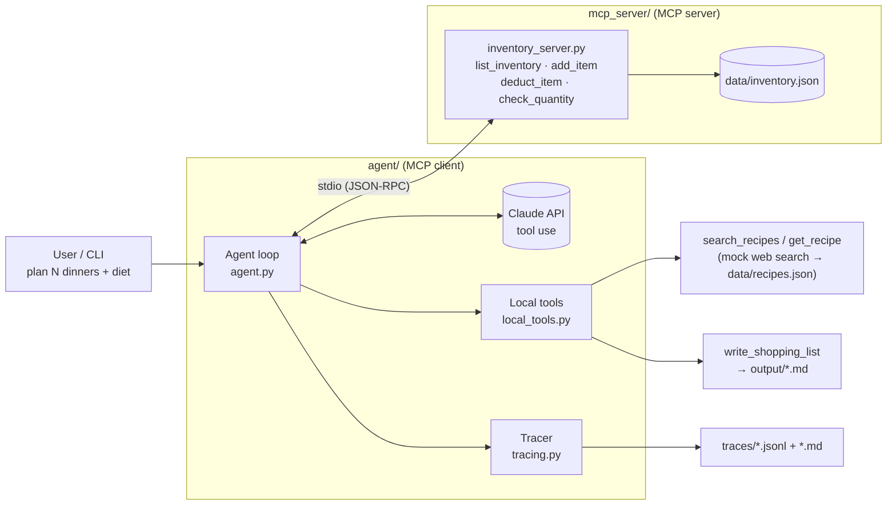

# Pantry Agent — Home-Inventory + Shopping Agent (MCP)

An LLM agent that plans **N dinners**, checks a pantry exposed through an **MCP server**,
writes a shopping list of **only the missing ingredients**, then simulates the shopping trip and
the week of cooking so the inventory is **updated after the week is consumed**.

- **LLM:** Claude (`claude-sonnet-5-5` by default, override with `--model` or `AGENT_MODEL`) via the Anthropic SDK tool-use API
- **MCP server:** Python `mcp` SDK (FastMCP), stdio transport, JSON-file persistence
- **No framework lock-in:** the agent loop is ~150 lines of plain Python, so every step is visible in the traces

---

## Architecture



```
pantry-agent/
├── mcp_server/inventory_server.py   # MCP server: 4 inventory tools, unit normalisation, validation
├── agent/
│   ├── agent.py                     # CLI + agent loop (MCP client + Claude tool use)
│   ├── local_tools.py               # recipe search (mocked), get_recipe, shopping-list writer
│   └── tracing.py                   # JSONL event log + Markdown trace renderer
├── data/
│   ├── inventory.seed.json          # starting pantry (copied to inventory.json with --reset)
│   └── recipes.json                 # 14-recipe mock catalogue with diet tags
├── traces/                          # run traces (deliverable)
├── output/                          # shopping lists written by the agent
└── tests/test_tools.py              # offline tests (no API key needed)
```

### How a run works

1. The client starts the MCP server as a subprocess (stdio) and calls `list_tools`.
2. MCP tools and local tools are merged into one tool list and sent to Claude.
3. Loop: Claude responds → every `tool_use` block is routed to the MCP server or a local
   function → results (with `is_error` when a tool failed) go back to Claude.
4. The procedure the agent follows (system prompt): read pantry → search + pick N recipes →
   aggregate quantities → compute missing = `max(0, need − have)` → write shopping list →
   `add_item` the purchases → `deduct_item` every recipe ingredient → confirm with `list_inventory` → final answer.
5. The run ends when Claude returns `end_turn`. The tracer then reads the final inventory
   **directly from the MCP server**, independent of what the model says.

### Tools

| Tool | Where | Notes |
|---|---|---|
| `list_inventory()` | MCP | Items with qty > 0 |
| `add_item(name, quantity, unit)` | MCP | `kg→g`, `l→ml`; creates the item if missing |
| `deduct_item(name, quantity, unit)` | MCP | Atomic: rejects missing items, wrong units, insufficient stock |
| `check_quantity(name)` | MCP | Returns 0 / `in_stock: false` when absent |
| `search_recipes(query, diet, exclude_ingredients)` | local (mock web search) | Raises an error on unknown diet tags or no matches |
| `get_recipe(recipe_id)` | local | Full ingredients + steps |
| `write_shopping_list(items, title)` | local | Validates items, writes `output/shopping_list_*.md` |

### Error handling and termination

- **Tool errors are not fatal.** They return to the model as `tool_result` with `is_error: true`
  and an actionable message ("Unknown unit 'cups'. Supported units: …", "No recipes matched. Try a broader query…"),
  so the model can **replan**. See `traces/trace_03_error_recovery_keto.md`: the recipe search fails,
  the agent broadens the search, and it explains that keto can't be fully met.
- **Bad CLI input** (no number of dinners, N > 7) is rejected before any API call.
- **Clean termination:** stops on `end_turn`. Hard cap at 40 turns. A guardrail tells the model
  to wrap up after 6 consecutive tool errors. The MCP subprocess is closed via `async with`.
  The exit code is 0 only when the status is `completed`.
- Name and unit normalisation on the server (`"  Olive OIL "` → `olive oil`) avoids duplicate items.

---

## Setup

Requires Python 3.10+.

```bash
git clone https://github.com/migueccubillos/pantry-agent.git && cd pantry-agent
python -m venv .venv && source .venv/bin/activate      # Windows: .venv\Scripts\activate
pip install -r requirements.txt
cp .env.example .env    # then put your key in .env, or just:
export ANTHROPIC_API_KEY="sk-ant-..."
```

Run the offline tests (no API key needed; they spin up the real MCP server over stdio):

```bash
python -m pytest -q
```

Optional: inspect the MCP server with the official inspector:

```bash
npx @modelcontextprotocol/inspector python mcp_server/inventory_server.py
```

## Example inputs

```bash
# 1. Basic week, fresh pantry
python -m agent.agent "plan 3 dinners" --reset

# 2. Dietary constraints + avoided ingredient, continuing from the previous pantry state
python -m agent.agent "plan 4 dinners for next week" --diet veggie --diet gluten-free --avoid mushrooms

# 3. Impossible constraint -> tool errors -> replanning
python -m agent.agent "plan 3 dinners" --diet keto --avoid garlic --reset
```

Flags: `--diet` (repeatable: vegetarian, vegan, gluten-free, dairy-free, pescatarian, high-protein),
`--avoid` (repeatable), `--reset` (restore `data/inventory.seed.json`), `--model`, `--run-name`.

Each run prints the menu, shopping list and final inventory, and writes:
- `traces/<run>.jsonl` — every LLM turn (stop reason, token usage, text) and every tool call (input, output, error flag, latency)
- `traces/<run>.md` — the same trace rendered for reading
- `output/shopping_list_<timestamp>.md`

## Included traces

| Trace | Scenario | Turns | Tool calls | Errors recovered |
|---|---|---:|---:|---:|
| [`trace_01_three_dinners`](traces/trace_01_three_dinners.md) | 3 dinners, no constraints, fresh pantry | 7 | 22 | 0 |
| [`trace_02_four_dinners_veggie_gf`](traces/trace_02_four_dinners_veggie_gf.md) | 4 dinners, vegetarian + gluten-free, no mushrooms, **pantry carried over from trace 1** | 7 | 35 | 0 |
| [`trace_03_error_recovery_keto`](traces/trace_03_error_recovery_keto.md) | Unsupported diet ("keto") → search error → replanning | 9 | 28 | 1 |

All final inventories were checked by hand against the recipes. For example, in trace 2:
eggs 1 in stock, 9 needed (5 + 4), 8 bought, 0 left; olive oil 370 − 100 − 15 = 255 ml.

## Design decisions and limitations

- **Mocked recipe search.** It runs on a local catalogue so the runs are reproducible and need no extra API keys.
  Swapping in a real API (Spoonacular, Edamam) only means changing `search_recipes`/`get_recipe`.
- **Shopping and cooking are simulated** with `add_item`/`deduct_item`, as the assignment asks
  ("updated inventory after the week is consumed").
- **Recipes use the pantry's units (g/ml/unit).** The LLM does the aggregation, and the server rejects any
  inconsistent deduction. A deterministic `compute_missing` tool would be a good next step for larger menus.
- Servings are fixed at 2 per recipe. Scaling for household size is not implemented.
